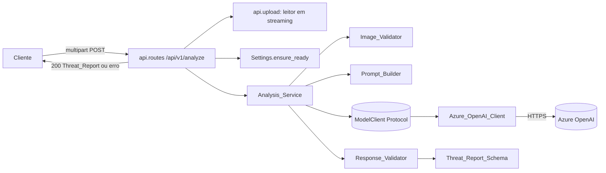
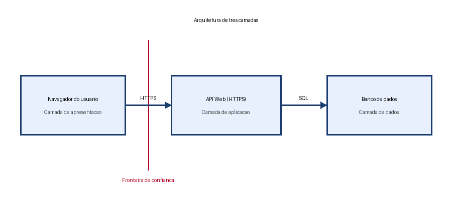

# STRIDE Threat Analysis API

API em Python e FastAPI que recebe a imagem de um diagrama de arquitetura, envia a imagem a um modelo com visão hospedado no Azure OpenAI e devolve uma análise de ameaças baseada na metodologia STRIDE.

## Aviso de revisão humana e uso ético e defensivo

> **Aviso de revisão humana:** Esta análise foi gerada por um modelo de linguagem e pode conter erros ou omissões. Ela exige revisão humana e deve ser usada apenas de forma ética e defensiva, em sistemas que você possui ou está autorizado a avaliar.

**Uso ético e defensivo.** Este projeto tem finalidade educacional e defensiva. Use a ferramenta somente para analisar sistemas que sejam seus ou para os quais você tenha autorização expressa de avaliação. A saída do modelo é tratada como dado não confiável e deve ser revisada por uma pessoa antes de qualquer decisão. Cada resposta da API traz esse aviso no campo `disclaimer`, inserido pela própria API e nunca copiado da saída do modelo.

## Objetivo

Ajudar analistas de segurança e times de desenvolvimento a obter um primeiro levantamento de ameaças a partir de um diagrama de arquitetura, sem produzi-lo manualmente. O projeto também serve como material de estudo sobre engenharia de prompt, validação de saída de LLM e desenvolvimento seguro de APIs.

A API expõe:

| Endpoint | Descrição |
|----------|-----------|
| `POST /api/v1/analyze` | Recebe `file` (PNG ou JPEG) e, opcionalmente, `context` (1 a 2000 caracteres). Retorna um relatório de ameaças em JSON. |
| `GET /health` | Retorna `{"status": "ok"}` sem chamar o Azure OpenAI. |
| `GET /docs` | Documentação interativa OpenAPI. |

## Arquitetura

As camadas dependem apenas de camadas mais internas. A rota HTTP delega ao serviço de análise, que usa uma interface de cliente de modelo (`ModelClient`). A implementação real fala com o Azure OpenAI. Nos testes, ela é trocada por um fake.



Pontos principais:

- A imagem existe apenas em memória. A leitura do upload é interrompida quando o limite de tamanho é ultrapassado, e nenhum byte é gravado em disco.
- A saída do modelo passa pelo esquema Pydantic antes de chegar ao cliente. Em caso de falha, a API devolve uma mensagem genérica, sem a saída bruta.
- Os segredos vêm somente de variáveis de ambiente.
- O texto dos prompts fica em módulos dedicados, fora da camada HTTP.

Imagem de exemplo de diagrama usada como entrada nos exemplos:



Detalhes e justificativas em [docs/decisoes-de-arquitetura.md](docs/decisoes-de-arquitetura.md).

## Metodologia STRIDE

STRIDE é um modelo de classificação de ameaças. Cada letra corresponde a uma categoria:

| Categoria | Valor na API | Propriedade violada | Descrição curta |
|-----------|--------------|---------------------|-----------------|
| **S**poofing | `Spoofing` | Autenticidade | Alguém se passa por outro usuário, serviço ou componente. |
| **T**ampering | `Tampering` | Integridade | Dados ou código são alterados sem autorização. |
| **R**epudiation | `Repudiation` | Não repúdio | Uma ação é negada por falta de registro ou prova. |
| **I**nformation Disclosure | `Information Disclosure` | Confidencialidade | Informação é exposta a quem não deveria acessá-la. |
| **D**enial of Service | `Denial of Service` | Disponibilidade | O serviço é degradado ou tornado indisponível. |
| **E**levation of Privilege | `Elevation of Privilege` | Autorização | Alguém obtém permissões além das concedidas. |

Cada ameaça do relatório tem `category`, `component`, `description`, `severity` (`Low`, `Medium`, `High` ou `Critical`) e `mitigation`. Os valores de `category` e `severity` são comparados de forma exata e sensível a maiúsculas.

## Pré-requisitos

- Python 3.12 ou superior.
- Uma assinatura do Azure com um recurso do Azure OpenAI e um deployment de modelo com capacidade de visão.
- `git` e `pip`.
- Para executar os testes, nenhuma credencial é necessária.

## Configuração do Azure OpenAI

1. No portal do Azure, crie (ou reutilize) um recurso do Azure OpenAI.
2. Implante um modelo com visão e anote o nome do deployment.
3. Copie o endpoint e uma das chaves do recurso, na página de chaves e endpoint.
4. Copie `.env.example` para `.env` e preencha os valores:

```dotenv
AZURE_OPENAI_ENDPOINT=<seu-endpoint>
AZURE_OPENAI_API_KEY=<sua-chave>
AZURE_OPENAI_DEPLOYMENT=<nome-do-deployment>
AZURE_OPENAI_API_VERSION=<versao-da-api>
MAX_IMAGE_SIZE_BYTES=5242880
```

| Variável | Descrição |
|----------|-----------|
| `AZURE_OPENAI_ENDPOINT` | Endpoint do recurso (`<seu-endpoint>`). |
| `AZURE_OPENAI_API_KEY` | Chave de API do recurso (`<sua-chave>`). |
| `AZURE_OPENAI_DEPLOYMENT` | Nome do deployment do modelo com visão (`<nome-do-deployment>`). |
| `AZURE_OPENAI_API_VERSION` | Versão da API do Azure OpenAI a usar. |
| `MAX_IMAGE_SIZE_BYTES` | Tamanho máximo da imagem em bytes. Opcional. Padrão de 5 MiB (5242880), máximo de 20971520. |

Nunca versione o arquivo `.env`: ele já está no `.gitignore`. Se endpoint, chave, deployment ou versão estiverem ausentes, ou se `MAX_IMAGE_SIZE_BYTES` for inválido, a API responde 503 apenas quando uma análise é solicitada. `/health` e `/docs` continuam disponíveis. Mais detalhes em [docs/consideracoes-de-seguranca.md](docs/consideracoes-de-seguranca.md).

## Instalação

```bash
git clone https://github.com/Gtvnv/stride-threat-analysis-api.git
cd stride-threat-analysis-api
python -m venv .venv
# Linux/macOS
source .venv/bin/activate
# Windows (PowerShell)
.venv\Scripts\Activate.ps1

pip install -e ".[dev]"
```

Para rodar apenas a API, `pip install -e .` é suficiente.

## Execução

Carregue as variáveis de ambiente do `.env` no seu shell (a aplicação lê o ambiente do processo) e inicie o servidor:

```bash
uvicorn app.main:app --reload
```

- Documentação interativa: `http://localhost:8000/docs`
- Verificação de saúde: `http://localhost:8000/health`

Para rodar os testes (sem credenciais e com a rede bloqueada):

```bash
pytest
```

A integração contínua roda a mesma suíte no GitHub Actions, sem segredos do Azure (`.github/workflows/ci.yml`).

## Exemplos de requisição e resposta

Arquivos de exemplo:

- Requisição: [examples/requisicao-exemplo.http](examples/requisicao-exemplo.http)
- Resposta: [examples/resposta-exemplo.json](examples/resposta-exemplo.json)
- Imagem de entrada: [images/exemplo-arquitetura.png](images/exemplo-arquitetura.png)

Requisição com `curl`:

```bash
curl -X POST "http://localhost:8000/api/v1/analyze" \
  -F "file=@images/exemplo-arquitetura.png;type=image/png" \
  -F "context=Aplicação web com frontend no navegador, API HTTPS e banco de dados relacional."
```

Resposta (200), trecho de [examples/resposta-exemplo.json](examples/resposta-exemplo.json):

```json
{
  "components": ["Navegador do usuario", "API Web (HTTPS)", "Banco de dados"],
  "data_flows": ["Navegador do usuario para API Web via HTTPS", "API Web para Banco de dados via SQL"],
  "trust_boundaries": ["Fronteira entre o navegador do usuario e a API Web"],
  "summary": "Arquitetura de tres camadas com navegador, API Web e banco de dados. ...",
  "threats": [
    {
      "category": "Spoofing",
      "component": "API Web (HTTPS)",
      "description": "Sem autenticacao visivel no diagrama, um atacante pode se passar por um usuario legitimo ao chamar a API.",
      "severity": "High",
      "mitigation": "Exigir autenticacao forte (por exemplo OAuth 2.0/OIDC) e validar tokens em todas as requisicoes."
    }
  ],
  "disclaimer": "Esta análise foi gerada por um modelo de linguagem e pode conter erros ou omissões. ..."
}
```

Erros usam um corpo uniforme, sem eco de segredos nem da saída do modelo:

```json
{"error": {"code": "unsupported_media_type", "message": "Tipo de conteúdo não permitido. Use image/png ou image/jpeg."}}
```

| Situação | HTTP | `code` |
|----------|------|--------|
| Arquivo ausente ou corpo não multipart | 400 | `file_missing` |
| Arquivo vazio | 400 | `file_empty` |
| Imagem maior que o limite | 413 | `file_too_large` |
| Tipo não permitido ou assinatura divergente | 415 | `unsupported_media_type` / `signature_mismatch` |
| `context` acima de 2000 caracteres | 422 | `context_too_long` |
| Configuração ausente ou inválida | 503 | `service_not_configured` |
| Erro do Azure ou saída do modelo inválida | 502 | `upstream_error` / `model_output_invalid` |
| Timeout de 60 s no Azure | 504 | `upstream_timeout` |

## Técnicas de engenharia de prompt

O `Prompt_Builder` aplica as seguintes técnicas:

1. **Papel (role prompting):** o modelo age como arquiteto de segurança sênior.
2. **Definições explícitas:** cada categoria STRIDE é definida, e os seis valores permitidos são listados.
3. **Few-shot:** de um a três exemplos de ameaça válida, validados nos testes contra o esquema.
4. **Saída estruturada:** formato JSON descrito campo a campo, com `response_format` do tipo `json_object` e temperatura baixa.
5. **Raciocínio em etapas:** o modelo identifica componentes, fluxos de dados e fronteiras de confiança antes de listar ameaças.
6. **Ancoragem na imagem:** só entram componentes visíveis no diagrama.
7. **Defesa contra injeção de prompt:** texto dentro da imagem e no campo `context` é tratado como dado, e instruções contidas nele são ignoradas.
8. **Caso vazio:** sem arquitetura identificável, a resposta tem `threats` vazio e um `summary` com o motivo.

Explicação completa em [docs/engenharia-de-prompt.md](docs/engenharia-de-prompt.md).

## Estrutura do projeto

```
app/
  main.py                  # create_app() e handlers de erro
  api/                     # rotas, leitor de upload em streaming, erros
  core/                    # Settings (variáveis de ambiente) e logging
  services/                # análise, validação de imagem e de resposta
  prompts/                 # prompt de sistema, few-shot e Prompt_Builder
  clients/                 # ModelClient (Protocol) e cliente Azure OpenAI
  schemas/                 # esquemas Pydantic (Threat, ThreatReport)
tests/                     # testes unitários, de propriedade e de API
docs/                      # documentação detalhada em pt-BR
examples/                  # requisição e resposta de exemplo
images/                    # diagrama de exemplo
tools/                     # utilitário para gerar o diagrama de exemplo
.github/workflows/ci.yml   # integração contínua
.env.example  .gitignore  LICENSE  pyproject.toml  README.md
```

Documentação adicional:

- [docs/decisoes-de-arquitetura.md](docs/decisoes-de-arquitetura.md): decisões de arquitetura e alternativas descartadas.
- [docs/engenharia-de-prompt.md](docs/engenharia-de-prompt.md): técnicas de prompt aplicadas.
- [docs/consideracoes-de-seguranca.md](docs/consideracoes-de-seguranca.md): considerações de segurança.
- [docs/licoes-aprendidas.md](docs/licoes-aprendidas.md): lições aprendidas.

Licença: MIT. O texto completo está em [LICENSE](LICENSE).

## Limitações

- A qualidade da análise depende do modelo e da legibilidade do diagrama. O modelo pode errar, omitir ameaças ou inventar detalhes. A revisão humana é obrigatória.
- Apenas PNG e JPEG são aceitos, com tamanho de 1 byte até o limite configurado (padrão de 5 MiB, máximo de 20 MiB).
- A API analisa o que está visível no diagrama. Detalhes de implementação, configuração e código não aparecem na análise, a menos que sejam informados em `context`.
- A análise é um ponto de partida e não substitui uma modelagem de ameaças feita por especialistas, testes de segurança ou auditoria.
- Cada requisição chama o modelo uma única vez, sem retentativas, com limite de 60 segundos. Falhas do Azure retornam 502 ou 504.
- Não há autenticação, limitação de taxa nem persistência de resultados. Para uso fora de um ambiente controlado, coloque a API atrás de um gateway com essas proteções.
- Os testes usam um cliente fake. A integração real com o Azure OpenAI não é exercitada na suíte automatizada.
